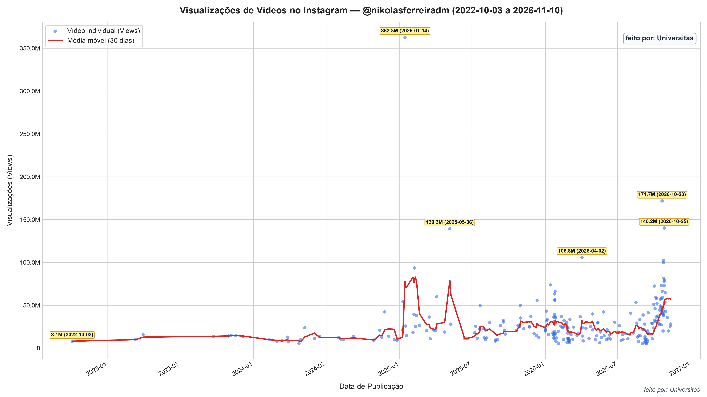

> Análise e coleta de dados feita pela [Universitas](https://universitas-io.github.io)

  <a href="/dados/views_por_data_meta-nikolas.html" target="_blank" rel="noopener noreferrer" class="hover:text-manifesto-red underline">
    [ ↗ ABRIR GRÁFICO INTERATIVO EM TELA CHEIA ]
  </a>

Resolvi medir os números de Nikolas Ferreira no Instagram diante do barulho que tomou conta do debate público nas últimas semanas. Entidades como Sleeping Giants Brasil, ARTIGO 19 e CTRL+Z chegaram a [protocolar uma representação no Ministério Público Eleitoral](https://iclnoticias.com.br/entidades-acionam-mp-eleitoral-nikolas/) cobrando explicações da Meta sobre o alcance do deputado (Lourenço, 2026). A cobrança faz sentido. Em período de eleição, saber se as regras do jogo estão sendo aplicadas de forma igual para todo mundo é uma exigência básica, e a própria Meta precisa responder a isso.

Quando olhamos os dados que coletamos na [Universitas](https://universitas-io.github.io)
, o salto fica nítido. A partir de 25 de setembro de 2026, a média móvel de 30 dias de visualizações nos vídeos (Reels) de Nikolas começa a subir de forma muito rápida. O momento eleitoral sempre aquece o consumo de conteúdo político, e como bem pontuou Umar Farooq na [Al Jazeera](https://www.aljazeera.com/features/2026/10/21/why-social-media-has-become-an-election-issue-in-brazils-presidential-race), as redes viraram o coração da disputa presidencial e legislativa no Brasil, com campanhas despejando grande parte do orçamento em anúncios no Instagram e no Facebook (Farooq, 2026). Mas o ritmo de crescimento aqui chama bastante atenção.

A comparação com outros atores políticos ajuda a entender o tamanho da disparidade. O [relatório que o Sleeping Giants entregou ao MPE](https://sleepinggiantsbrasil.com/wp-content/uploads/2026/10/Dossie_Meta_nao_se_meta_eleicoes_2026_diagramado.pptx.pdf) mostrou que dez vídeos de Nikolas somaram 410,5 milhões de visualizações (Lourenço, 2026). Para termos uma ideia, o mesmo estudo analisou 90 vídeos de outros nove deputados federais de vários partidos: juntos, todos eles somaram 137,3 milhões. Ou seja, com um nono da quantidade de postagens, Nikolas teve quase o triplo de visualizações. Cada um desses dez vídeos superou o número total de seguidores do parlamentar, com o menos assistido batendo 23,3 milhões. Quando comparamos esse volume com perfis de entretenimento, como grandes atletas e músicos internacionais, Nikolas atinge médias por post que competem ou até superam figuras desse porte.

Isso não quer dizer que o engajamento dele seja puramente artificial. Nikolas tem capacidade real de mobilização. Com mais de 25 milhões de seguidores, ele é o deputado federal mais votado da história do país, e fingir que isso não conta seria equivocado. Sua votação expressiva comprova sua força nas redes e vice-versa. O ápice dessa curva nos nossos dados foi o vídeo sobre o Pix, em janeiro de 2025, que passou de 362 milhões de visualizações. Naquela época, o pico aconteceu sobre uma média móvel bem mais baixa do que a atual. O que vemos agora em 2026 é um patamar alto sustentado, postagem após postagem.

Parte da explicação está na própria mecânica do conteúdo. Os vídeos que mais explodem são justamente os que furam a bolha e chegam na esquerda. O *ragebait* gera views, indignar o adversário é uma das formas mais eficientes de fazer o algoritmo distribuir o vídeo, porque a revolta gera comentário, compartilhamento e tempo de tela. Aprendemos com os estudos dos movimentos sociais que até mesmo a ***dissonância*** gera ***visibilidade*** (Koopmans; Olzak, 2004). A estratégia de André Janones (REDE) de pedir ao exército do Lula de nem ver os vídeos da direita é certeira, dando menos oportunidade de engajamento para o adversário, pois se até o público de esquerda vê o vídeo, ele ganha a oportunidade de interagir com um público que antes estaria fora de alcance, ganhando, assim, mais ***visibilidade***. Mas mesmo com esse efeito, a disparidade é grande demais para ser explicada apenas por mérito de conteúdo.

### Mas e aí? A Meta está mesmo interferindo?

Com certeza absoluta ninguém de fora pode afirmar, porque os algoritmos são caixas-pretas e a empresa não abre os dados de tráfego. Mas a disparidade está ali na tela. E quando olhamos o comportamento da Meta, as dúvidas só aumentam. Como documentou a jornalista Laís Martins no Tech Policy Press, a atuação da plataforma na reta final das eleições brasileiras foi cheia de decisões erráticas: a empresa chegou a travar sem explicação clara os anúncios da campanha do presidente Lula e tirou do ar a conta do projeto independente Revelando Brasil logo depois de publicarem denúncias contra o senador Flávio Bolsonaro, voltando atrás apenas após pressão e denúncias públicas de censura (Martins, 2026).

Essa assimetria é perigosa. Se a Meta decide arbitrariamente quem pode impulsionar conteúdo, quem tem conta suspensa ou quem recebe distribuição privilegiada nos dias que antecedem a votação, a própria integridade do processo eleitoral fica ameaçada. O Tribunal Superior Eleitoral vem tentando colocar limites e cobrar transparência das big techs, mas sem acesso aos dados técnicos fica impossível saber se as restrições sobre recomendação política estão valendo para todos.

Por fim, há um fator estrutural que os números deixam claro. A direita vem construindo capacidade comunicacional nas redes sociais desde 2014, enquanto a esquerda demorou mais para se organizar nesse terreno (que também não é favorável). Eles já têm a argamassa pronta para levantar a parede, e nós muitas vezes ainda estamos levando os ingredientes para o canteiro de obras. Esse mérito político e comunicacional deles existe e precisa ser reconhecido. Mas o debate sobre o algoritmo da Meta não pode ser tratado apenas como mérito de quem cria conteúdo. Cobrar transparência da empresa não é negar o alcance de Nikolas, e sim defender que a disputa política aconteça em um terreno com regras claras para todo mundo, o que aparentemente é um sonho distante. Estamos lutando contra um sistema que não se pretende transparente e que tem como principal fonte de receita a venda de anúncios, e não a promoção da democracia, mesmo que a liberal.

> A *ploutos* perdeu a muito tempo a vergonha de se esconder atrás do *demos*.

### Referências

FAROOQ, Umar. Why social media has become an election issue in Brazil’s presidential race. **Al Jazeera**, 21 out. 2026. Disponível em: <https://www.aljazeera.com/features/2026/10/21/why-social-media-has-become-an-election-issue-in-brazils-presidential-race>. Acesso em: 23 out. 2026.

KOOPMANS, Ruud; OLZAK, Susan. Discursive Opportunities and the Evolution of Right‐Wing Violence in Germany. American Journal of Sociology, v. 110, n. 1, p. 198–230, jul. 2004. 

LOURENÇO, Cleber. **Entidades acionam MP Eleitoral para investigar possível favorecimento da Meta a Nikolas**. ICL Notícias, 23 out. 2026. Disponível em: <https://iclnoticias.com.br/entidades-acionam-mp-eleitoral-nikolas/>. Acesso em: 23 out. 2026.

MARTINS, Laís. **On Eve of Brazil Elections, Meta Content Moderation Decisions Raise Questions**. Tech Policy Press, 30 set. 2026. Disponível em: <https://techpolicy.press/on-eve-of-brazil-elections-meta-content-moderation-decisions-raise-questions>. Acesso em: 23 out. 2026.
